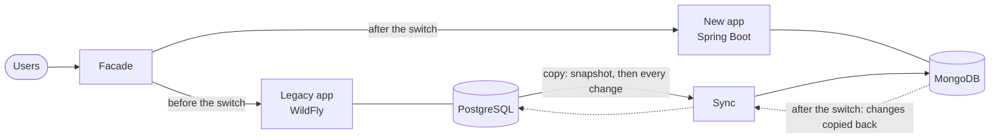

# kitchensink on MongoDB

The JBoss EAP **kitchensink** quickstart, rebuilt with **Java 21 and Spring Boot 4 on MongoDB**, together with
everything needed to move its data out of the old PostgreSQL database: **no data lost, and writes paused for only
a few seconds**, with a way back at every step.

Everything runs on one laptop with **only a JDK**: no Docker, no database to install.

## What you need

- **JDK 21**. Check with `java -version` and `.\mvnw.cmd -v`: both must show 21. Maven uses `JAVA_HOME`, which can
  point to another JDK than `java`.
- An **internet connection** the first time. Maven, the libraries, PostgreSQL, WildFly and MongoDB are downloaded
  once, then cached.
- About **8 GB of RAM** and **3 GB of disk**.

## Run it

On Windows, in a terminal (Command Prompt or PowerShell) at the root of the repository:

```bat
.\mvnw.cmd package -DskipTests
.\ks start
```

On macOS or Linux: `./mvnw package -DskipTests`, then `./ks start`.

The build takes about 5 minutes the first time. `ks start` then starts six things, and stays running:

| What | Where |
|---|---|
| The **legacy** application (unchanged, on WildFly) and its PostgreSQL database with 10,000 members | http://localhost:8180/kitchensink/ |
| The **new** application on MongoDB | http://localhost:8080/ |
| Its **API** documentation | http://localhost:8080/swagger-ui.html |
| The **sync**, which copies the legacy's data into MongoDB and keeps it up to date | http://localhost:8081/sync/status |
| The **facade**, which every user goes through. It decides which application answers | http://localhost:8000/kitchensink/ |

At first the legacy owns its 10,000 members and MongoDB is empty: `ks sync` loads it (below). Stop everything with
**Ctrl+C**. The next start keeps the data, and the sync carries on where it was; `ks reset` deletes it all, to start
from scratch.
If the window was closed instead, the next `ks start` stops what was left running, or run `ks stop`.

## Do the migration

Open a **second terminal** while `ks start` runs. Below, `ks` means `.\ks` on Windows and `./ks` on macOS or Linux.

| Command | What it does |
|---|---|
| `ks rules` | Plays the legacy's rules, recorded as 21 request and response cases, through the facade. `ks rules legacy` plays them on the legacy itself |
| `ks sync` | The initial load: copies the legacy's members into MongoDB, then streams every change. Run it first |
| `ks status` | Which application owns the data, and the state of the copy |
| `ks dual-run` | Sends reads to both applications and compares their answers |
| `ks reconcile` | Compares every record in both databases (counts and hashes) |
| `ks rehearse` | Switches to the new application and back, under live traffic. It times the pause and checks that no registration was lost |
| `ks cutover` | The real switch. It checks everything first, then asks you to type `yes` |
| `ks rollback` | Gives the writes back to the legacy, without losing what was written since the switch |
| `ks traffic` | Readers and writers through the facade, like real users. Run it during a cutover in a third terminal |
| `ks stop` | Stops everything `ks start` runs, even if its window was closed |

A typical session: `ks rules legacy`, `ks sync`, `ks reconcile`, `ks dual-run`, `ks rehearse`, then
`ks cutover`, `ks rules` (the new application now answers) and `ks rollback`.

## Run the tests

```bat
.\mvnw.cmd verify
```

The tests start their own MongoDB and PostgreSQL. They include the **characterization suite**: the legacy's
behaviour, recorded as request and response cases, replayed against the new application.

To replay the same cases against the running system, `ks rules` (above).

## How it works



- **One application owns the data at a time.** Before the switch the legacy owns it, and the sync copies every
  change into MongoDB. After the switch the new application owns it, and the sync copies every change back, so a
  rollback loses nothing.
- **The copy is proven before anyone depends on it**: the reconciliation compares every record, and the dual-run
  compares live answers.
- **The switch** pauses writes for a few seconds, makes sure both databases are identical, and moves the writes.

| Folder (each has its own README) | What |
|---|---|
| [`kitchensink-domain`](kitchensink-domain) | The member and its validation rules |
| [`kitchensink-app`](kitchensink-app) | The new application: the page, the legacy REST API (unchanged contract) and a new versioned API |
| [`kitchensink-sync`](kitchensink-sync) | The data migration: initial copy and change data capture, reconciliation, copy back |
| [`kitchensink-facade`](kitchensink-facade) | The router in front of both applications, with the dual-run and the write pause |
| [`characterization`](characterization) | The legacy's behaviour as test cases, run against both applications |
| [`legacy`](legacy) | The original quickstart, unchanged, packaged to run on PostgreSQL |
| [`local`](local) | The `ks` tool: starts everything, runs the cutover and rollback |

More detail, kept short:
- [How the new application is built](docs/architecture.md)
- [How the data moves, and how the switch works](docs/migration.md)
- [What the legacy does, rule by rule](docs/legacy-assessment.md)
- [The main decisions and their trade-offs](docs/decisions.md)
- [How this approach scales to a large application](docs/at-scale.md)
- [The presentation](docs/presentation): the talk on this migration, one web page that works offline

## If something goes wrong

- **"release version 21 not supported"** or **"This build needs JDK 21"**: Maven runs on an older JDK. Point
  `JAVA_HOME` to a JDK 21 (see below), open a new terminal, and check `.\mvnw.cmd -v`.
- **No JDK 21, no admin rights**: download the **zip** of Temurin 21 from https://adoptium.net and unzip it anywhere,
  or let IntelliJ download one (*File → Project Structure → SDKs → + → Download JDK*). Then, in PowerShell:
  ```powershell
  $env:JAVA_HOME = "C:\path\to\jdk-21"
  $env:Path = "$env:JAVA_HOME\bin;$env:Path"
  ```

- **"ks start" is running**: press Ctrl+C in its window, or run `ks stop`.
- **"Port … is already in use"** or **"The process cannot access the file"**: run `ks stop`. If that is not enough,
  another program uses the port or the file: stop it.
- **Behind a corporate proxy**: give Maven your proxy in `%USERPROFILE%\.m2\settings.xml`. For the MongoDB
  download, start with `set JAVA_TOOL_OPTIONS=-Dhttps.proxyHost=<host> -Dhttps.proxyPort=<port>`.
- **A service does not start**: its log is in `.local/logs/`.
